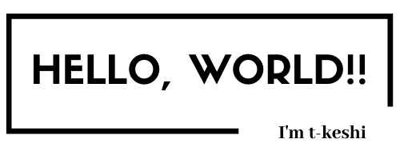

# 👋 Hi there

- ❤️ I'm a React and TypeScript Enthusiast
- 🌱 I’m currently learning Serverside Kotlin
- 😄 Pronouns: he/him
- 📫 How to reach me `quick.resp.biz094@gmail.com`
- 📝 I regularly write articles on [zenn.dev](https://zenn.dev/t_keshi)
- ⚡️ Examples of work [積読ミシュラン](https://tsundoku-michelin.vercel.app/books-list/1)

#  Latest Blog Posts

<!-- BLOG-POST-LIST:START -->
- [Agile Language Learning —エンジニアによるエンジニアのための英語学習法—](https://zenn.dev/t_keshi/articles/agile-language-learning1)
- [LLM時代の言語選定――こんな時代だからこそGolang?!](https://zenn.dev/t_keshi/articles/go-in-the-roaring-age)
- [明日から使えるTypeScriptの応用テクニックその3 -Polymorphic Component編-](https://zenn.dev/t_keshi/articles/tips-typescript-3)
- [明日から使えるTypeScriptの応用テクニックその2 -判別可能なUnion/Distribution編-](https://zenn.dev/t_keshi/articles/tips-typescript-2)
- [明日から使えるTypeScriptの応用テクニックその1 -Mapped/ConditionalTypes編-](https://zenn.dev/t_keshi/articles/tips-typescript-1)
- [You and 120% Cleaner React](https://zenn.dev/t_keshi/books/you-and-cleaner-react)
- [本気で考えるReactのベストプラクティス！bulletproof-react2022](https://zenn.dev/t_keshi/articles/bulletproof-react-2022)
<!-- BLOG-POST-LIST:END -->